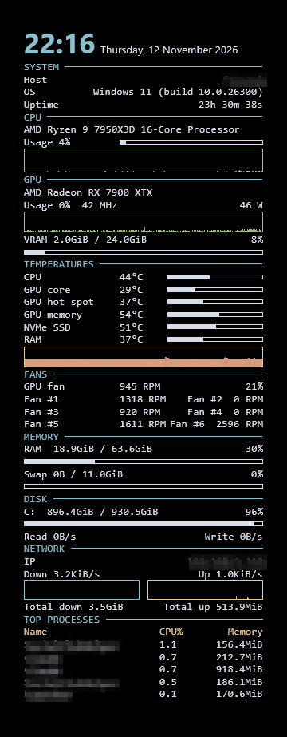

# congee

A [conky](https://github.com/brndnmtthws/conky)-style system monitor for Windows 10/11.
It draws live system stats as text, bars and graphs straight onto your desktop: clock, CPU, GPU, memory, disks, network,
top processes, temperatures, fan speeds and battery. A plain-text config file controls everything, just like conky.

<p align="center"></p>

- [Editions: Python or .NET](#editions-python-or-net)
- [Requirements](#requirements)
- [Install](#install)
- [Run](#run)
- [Configure](#configure)
- [Temperatures, fans and GPU stats](#temperatures-fans-and-gpu-stats)
- [Reference: settings](#settings)
- [Reference: variables](#variables)
- [Troubleshooting](#troubleshooting)
- [Project layout](#project-layout)
- [License](#license)

## Editions: Python or .NET

congee comes in two editions. Both read **the same config files from the same places** and support the same settings
and variables, so you can switch between them at any time.

| | Python edition (`congee.py`) | .NET edition (`dotnet\`) |
|---|---|---|
| Needs | Python 3.12 + the psutil package | .NET 10 Desktop Runtime |
| Text quality | Colour-key transparency: text can get a slight dark edge on bright wallpapers | True per-pixel transparency: clean anti-aliased text on any wallpaper |
| Semi-transparent background (`own_window_transparent no`) | Fades the whole widget, text included | Fades only the background, like real conky |
| Memory use (Task Manager) | ~35 MB | ~80 MB (WPF baseline; steady over time; ~115 MB with `rendering hardware`) |
| Start it with | `start.bat` | `dotnet\publish\congee.exe` |
| Best if | You want the smallest footprint or want to hack on it in Python | You want the best-looking text |

Run **one edition per config at a time**; otherwise both draw in the same spot. You can run several widgets at once,
each with its own config (`-c other.conf`).

## Requirements

| Requirement | Needed for | Get it |
|---|---|---|
| Windows 10 or 11 | Both editions | |
| Python 3.12 | Python edition | `winget install Python.Python.3.12` or [python.org](https://www.python.org/downloads/) |
| psutil (Python package) | Python edition | Installed by the setup step below (`requirements.txt`) |
| .NET 10 Desktop Runtime | .NET edition, to **run** it | `winget install Microsoft.DotNet.DesktopRuntime.10` |
| .NET 10 SDK | .NET edition, only to **build** it from source (includes the runtime) | `winget install Microsoft.DotNet.SDK.10` |
| congee sensor service | *Recommended*: temperatures, fan speeds, GPU stats. Comes with congee | Setup installs it ([details below](#temperatures-fans-and-gpu-stats)) |
| .NET 10 Runtime | The sensor service (already part of the .NET 10 Desktop Runtime) | `winget install Microsoft.DotNet.Runtime.10` |
| PawnIO driver | The sensor service, for CPU and motherboard sensors | `winget install namazso.PawnIO` |

congee itself never needs admin rights. Everything except hardware sensors works without the sensor service;
sensor lines just hide themselves or show `N/A`.

## Install

### Easiest: the setup wizard

Download `congee-setup-<version>.exe` from the [latest release](https://github.com/fl4tty/congee/releases/latest)
and run it, or [build it yourself](#building-the-installer). congee installs for your user only, into
`%LOCALAPPDATA%\Programs\congee`, with no admin rights; only the sensor service and PawnIO ask for admin permission,
once. The installer isn't code-signed, so Windows SmartScreen may warn you:
choose *More info* → *Run anyway*.

1. **Edition page:** pick the .NET edition (recommended) or the Python edition. Each has a short description of
   how it looks, how much memory it uses and what it needs (see [Editions](#editions-python-or-net)). If you switch
   editions later by running setup again, setup removes the one you didn't pick.
2. **Requirements page:** setup lists what the edition you picked needs or can use and checks what's already on
   your PC. Installed items are ticked and greyed out. Missing ones are unticked and marked *Missing*, with where
   they come from. Tick any you want, and when you click Install setup installs
   them from their official source with winget, Windows' built-in package manager:
   - The congee sensor service (recommended; it comes with congee, so it's ticked when missing): temperatures, fans
     and GPU stats. Windows asks for admin permission to install it. See
     [Temperatures, fans and GPU stats](#temperatures-fans-and-gpu-stats).
   - PawnIO (recommended, from pawnio.eu): the driver the service reads CPU and motherboard sensors with. Ticked when
     missing; its installer asks for admin permission.
   - .NET 10 Runtime (Python edition, for the sensor service, from Microsoft). The .NET edition's Desktop Runtime
     already includes it.
   - .NET 10 Desktop Runtime (.NET edition only, from Microsoft)
   - Python 3.12 (Python edition only, from python.org): installed for your user only
   - winget itself (App Installer, from the Microsoft Store), if it's missing: setup opens its Store page

   Without winget, or if a winget install fails, setup opens that item's download page instead. Setup warns you if
   you leave the runtime your edition needs unticked.
3. **Choose extras:** start congee with Windows, desktop shortcut.
4. Setup copies the files and builds the Python environment (`.venv` with psutil) if you picked the Python edition.
   It also puts a starter config in `%APPDATA%\congee\congee.conf`, but only if you don't already have one.
   When you upgrade, setup adds the new version's features to your existing config, such as the drive list and
   the GPU driver line. It only changes lines that still match an older default config, so your own changes stay,
   and it saves your old config as `congee.conf.bak` first. To run this yourself:
   `powershell -ExecutionPolicy Bypass -File "%LOCALAPPDATA%\Programs\congee\upgrade-config.ps1"`.
5. On the last page you can start congee.

When you upgrade congee and the sensor service has changed, setup updates it too, which asks for admin permission
again.

The Start menu gets *congee*, *Edit congee config*, the README and *Uninstall congee*. Uninstalling stops any
running congee and removes the program and the sensor service (Windows asks for admin permission), but **keeps your
config** in `%APPDATA%\congee`. There's one sensor service per PC, so if several people on the PC use congee,
uninstalling it for one removes the service for all of them; running setup again puts it back.

If setup installed PawnIO, Python 3.12 or a .NET 10 runtime for you (or LibreHardwareMonitor, which older versions
of congee used),
uninstalling lists them with checkboxes, all unticked, so you can remove them too. Leave them if other programs use
them (LibreHardwareMonitor uses PawnIO too). Ticked ones are removed with winget; removing a .NET runtime or PawnIO asks for admin permission, and
LibreHardwareMonitor is stopped first. Apps you had installed yourself aren't listed. Setup keeps track of what it
installed under `HKCU\Software\congee\InstalledDeps`. A silent uninstall (`/SILENT` or `/VERYSILENT`) leaves them
all installed.

#### Building the installer

You need the .NET 10 SDK and Inno Setup 6 (`winget install JRSoftware.InnoSetup`). Then:

```powershell
powershell -ExecutionPolicy Bypass -File installer\build.ps1
```

This publishes the .NET edition and compiles `installer\congee.iss` into `installer\Output\congee-setup-<version>.exe`.

### Manual install

Put the `congee` folder wherever you like (e.g. `C:\Users\<you>\Projects\congee`). Then set up the edition you want.
All commands below are run from inside that folder.

### Python edition

```bat
py -3.12 -m venv .venv
.venv\Scripts\pip install -r requirements.txt
```

This creates a private Python environment in `.venv` with psutil. If you move or rename the folder, delete `.venv`
and run these two commands again.

### .NET edition

If `dotnet\publish\congee.exe` already exists, you only need the .NET 10 Desktop Runtime (see [Requirements](#requirements)).
To build it yourself (needs the .NET 10 SDK):

```bat
cd dotnet
dotnet publish -c Release -r win-x64 --self-contained false -p:PublishSingleFile=true -o publish
```

This produces `dotnet\publish\congee.exe` (about 250 KB) next to a copy of the default `congee.conf`. Re-run it after changing any `.cs` file.

### Create your own config

```bat
.venv\Scripts\python congee.py --create-config
:: or, .NET edition:
dotnet\publish\congee.exe --create-config
```

This copies the default config to `%APPDATA%\congee\congee.conf`. That's the file to edit; see [Configure](#configure).
It never overwrites an existing file.

### Start with Windows

Press `Win+R`, type `shell:startup`, press Enter, and put a shortcut in that folder to **one** of:

- Python edition: `start.bat`
- .NET edition: `dotnet\publish\congee.exe`

congee starts the sensor service itself when it opens.

## Run

| | Python edition | .NET edition |
|---|---|---|
| Start the widget | `start.bat` | `dotnet\publish\congee.exe` |
| Use another config | `start.bat -c other.conf` | `dotnet\publish\congee.exe -c other.conf` |

Command-line options (the same in both editions; Python ones run as `.venv\Scripts\python congee.py <option>`):

| Option | What it does |
|---|---|
| `-c FILE`, `--config FILE` | Use this config instead of searching for one |
| `--once` | Print one frame as plain text and exit. Handy for testing a config |
| `--sensors` | Say where sensors are read from, then list every hardware sensor and the GPUs found |
| `--interfaces` | List network interface names, for `${downspeed Ethernet}` etc. |
| `--which-config` | Show which config file would be used |
| `--create-config` | Copy the default config to `%APPDATA%\congee\congee.conf` |
| `--help` | Show all options |

**Using the widget:**
- **Tray icon:** congee puts its icon in the notification area (system tray, next to the clock). Click or right-click it for:

  | Menu item | Does |
  |---|---|
  | Hide widget / Show widget | Hide the widget without stopping it (e.g. while gaming or screen-sharing) |
  | Edit config | Open the config file in use |
  | Open config folder | Open the folder that holds it |
  | Reload config | Re-read the config now (saving the file also does this) |
  | Reset position | Move it back to where the config places it, after dragging |
  | Logging | Turn the [log file](#log-file) on or off (checked = on). Saved in your config as `logging yes/no` |
  | Exit congee | Stop congee |

  Windows 11 tucks new tray icons behind the **^** arrow. To keep congee's icon on the taskbar, go to
  **Settings → Personalization → Taskbar → Other system tray icons** and turn on **congee**, or drag the icon out of
  the **^** panel onto the taskbar. Each running copy has its own icon; its tooltip names the config file if it isn't
  the default `congee.conf`.
- **Right-click** the widget's text for the same menu. With a transparent background, clicks between the letters go
  through to the desktop, so aim at the text itself. With `click_through yes`, only the tray icon works.
- **Left-drag** it to move it until the next reload (`draggable no` turns this off; set `gap_x`/`gap_y` to place it
  permanently).
- It sits on the desktop: above the wallpaper, below every app window, and not in the taskbar or Alt-Tab.

## Configure

### Where the config lives

Without `-c`, congee uses the first of these files that exists, like conky's `~/.config/conky/conky.conf` then `~/.conkyrc`:

1. `%APPDATA%\congee\congee.conf`: **your config** (made by `--create-config`)
2. `%USERPROFILE%\.config\congee\congee.conf`
3. `%USERPROFILE%\.congeerc`
4. `congee.conf` next to the program: the bundled default, which is also the template

Tray icon → **Edit config** always opens the file in use. To start over, delete your copy and run `--create-config` again.

### Editing it

1. Open the config (tray icon → **Edit config**).
2. Change something and save. The widget redraws within a second; no restart is needed.
3. If you make a mistake, the widget shows the error in red instead of crashing.

The file has two parts: **settings** (one `name value` per line) above a line that says `TEXT`, and the **template**
below it. In the template, plain text is shown as-is and `${variables}` are replaced with live values:

```
# --- settings ---
alignment top_right
gap_x 24
font Consolas:size=10
color1 88c0d0

TEXT
${color1}CPU${color} ${cpu}%  ${cpubar 6,120}
RAM ${mem} / ${memmax}${alignr}${memperc}%
${if_gpu}GPU ${gpu_name}: ${gpu_temp}°C, ${gpu_load}%
${endif}${time %H:%M:%S}
```

Lines starting with `#` in the settings part are comments. The conky 1.10+ Lua format works too, so many existing conky
configs work unchanged (apart from Linux-only variables, which are shown as plain text):

```lua
conky.config = { alignment = 'top_left', gap_x = 30, font = 'Consolas:size=11' }
conky.text = [[
CPU ${cpu}% ${cpubar}
]]
```

### Common changes

| To… | Use |
|---|---|
| Move it to another corner | `alignment top_left` (or `bottom_right`, `middle_middle`, `tl`, `br`…) |
| Nudge it | `gap_x 40`, `gap_y 80` (pixels from the edge) |
| Put it on another monitor | `monitor 1` |
| Make it wider | `minimum_width 400` |
| Change the font | `font Segoe UI:size=11`, or inline: `${font Consolas:bold:size=14}…${font}` |
| Change colours | `default_color white`, `color1 88c0d0`, then `${color1}…${color}` in the template |
| Give it a background | `own_window_transparent no`, `own_window_colour 101418`, `own_window_argb_value 180` |
| Keep it above other windows | `own_window_type override` |
| Let clicks pass through it | `click_through yes` (the right-click menu then only works from the tray icon) |
| Update less often | `update_interval 2` |
| Show only some drives | Replace the `${for_each_drive}` block with one line per drive, e.g. `${fs_used D:\}` and `${fs_bar 6,0 D:\}` |
| Leave out mapped network drives and DVD drives | `${for_each_drive local}` |
| Show temperatures in Fahrenheit | `temperature_unit fahrenheit` (write `${temp_unit}` after a temperature to get °F/°C to match) |
| Right-align part of a line | `Label${alignr}value` |
| Line things up in columns | `Name${goto 170}Value` |
| Show something only sometimes | `${if_running Discord}Discord is open${endif}` |
| Show a command's output | `${execi 60 powershell -NoProfile -Command "(Get-Date).DayOfYear"}` |

Bars and graphs take an optional `height,width`: `${cpubar 6,120}`. A width of `0`, or no size at all, stretches to fill
the rest of the line. Graphs also take two colours for a gradient: `${cpugraph 30,0 a3be8c bf616a}`.

## Temperatures, fans and GPU stats

Windows only lets programs read temperatures and fan speeds with administrator rights and a hardware driver. congee
doesn't run as administrator, so a small helper does that part: the **congee sensor service** (`congee-sensors`).

- It's a Windows service, so it has no window or tray icon. Setup installs it once, with one admin prompt, into
  `C:\Program Files\congee\sensors` (where only administrators can change it, because it runs as the system account).
- It runs only while congee does: congee starts it when it opens and stops it when you exit congee, with no admin
  prompt (setup lets signed-in users start and stop this one service, but not change or remove it). For the first few
  seconds after congee opens, while the service finds the hardware, the widget says *finding hardware…* where the
  temperatures go.
- It uses [LibreHardwareMonitorLib](https://github.com/LibreHardwareMonitor/LibreHardwareMonitor), the sensor engine
  inside LibreHardwareMonitor, and its [PawnIO](https://pawnio.eu/) driver for CPU and motherboard sensors. Without
  PawnIO it still reads GPU stats, but not CPU temperatures or motherboard fans.
- It serves the readings only to this PC, on `http://127.0.0.1:8086/data.json`, in the same format as
  LibreHardwareMonitor's web server, so sensor names and paths are the same as with LHM.
- It only reads the hardware when congee asks (at most about once a second). While running it uses about 120 MB of
  memory, about half of what the LibreHardwareMonitor app uses.
- Check it works: `congee.exe --sensors` (or `.venv\Scripts\python congee.py --sensors`) lists every sensor and the
  GPUs found. With congee closed it starts the service for this and stops it again after. In **Services** (`services.msc`) it's listed as *congee sensors*.
- To install or remove it by hand, from an administrator terminal:
  `"%LOCALAPPDATA%\Programs\congee\sensors\congee-sensors.exe" --install` or `--uninstall`.

congee (versions before 1.3.0) used the LibreHardwareMonitor app for this. It doesn't any more: you can close or
uninstall LibreHardwareMonitor unless you use it for something else. The two can run side by side.

### Sensors in your config

**Any hardware brand.** The default config uses the `gpu_*` and `cpu_*` variables, so it works unchanged on AMD, NVIDIA and
Intel GPUs and on AMD and Intel CPUs. Each of those variables tries every brand's sensor names in turn
(e.g. `cpu_temp` reads `Core (Tctl/Tdie)` on AMD and `CPU Package` on Intel). Lines for hardware a PC doesn't have,
like a GPU hot spot or a RAM temperature sensor, are hidden with `${if_gpu_sensor …}` / `${if_sensor …}`.

**Choosing the GPU** (PCs with integrated graphics plus a graphics card, or several cards). The `gpu` setting picks which
GPU the `gpu_*` variables read:
- `auto` (default) prefers a dedicated card over integrated graphics, then the card with the most VRAM.
- `0`, `1`… picks by the order `--sensors` lists them.
- Any other text is matched against the GPU's name, e.g. `gpu GeForce`.

**Reading any sensor by name.** `${temp NAME}`, `${fan NAME}` and `${sensor TYPE NAME}` read any sensor that `--sensors`
lists. A `NAME` matches a sensor's exact name first, then any part of its path, so `${temp Tctl}` matches
`AMD Ryzen 9 7950X3D/Temperatures/Core (Tctl/Tdie)`. Use a longer path fragment to tell apart sensors with the same name,
e.g. `${sensor clock Radeon RX 7900 XTX/Clocks/GPU Core}`.

Motherboard fan headers show up as `Fan #1`…`Fan #N`. Which header is which depends on the board, so check them
against the BIOS. Delete lines for fans you don't have plugged in.

**NVIDIA without the sensor service:** `nvidia-smi` comes with the NVIDIA driver and needs no admin:
`${execi 2 nvidia-smi --query-gpu=utilization.gpu,temperature.gpu --format=csv,noheader}`

## Settings

| Setting | Default | Notes |
|---|---|---|
| `alignment` | `top_right` | `top_/middle_/bottom_` + `left/middle/right`, or `tl`, `br`, `mm`… |
| `gap_x`, `gap_y` | 20, 40 | Pixels from the screen edge (the taskbar area is excluded) |
| `monitor` | 0 | 0 = primary monitor, 1+ = the others |
| `minimum_width`, `minimum_height` | 0 | Content size in pixels. Set a width if you use auto-width bars or graphs |
| `update_interval` | 1.0 | Seconds between updates |
| `font` | `Consolas:size=10` | `Family:size=N[:bold][:italic]`, `Family:pixelsize=N`, or `Family N` |
| `default_color`, `color0`–`color9` | white | Names (`white`) or hex (`88c0d0` / `#88c0d0`) |
| `draw_shades`, `default_shade_color` | yes, black | 1px drop shadow; helps readability on bright wallpapers |
| `draw_outline`, `default_outline_color` | no, black | |
| `draw_graph_borders` | yes | |
| `default_bar_height`, `default_graph_height` | 6, 24 | |
| `own_window_type` | `desktop` | `desktop` = above the wallpaper, below all windows; `normal`; `override` = always on top |
| `own_window_transparent` | yes | `no` = `own_window_colour` background at `own_window_argb_value` (0–255) opacity |
| `own_window_colour` | `#101418` | Background colour when not transparent |
| `own_window_argb_value` | 200 | Background opacity, 0–255 |
| `border_inner_margin` | 8 | Padding |
| `click_through` | no | `yes` lets clicks pass through (use the tray icon for the menu) |
| `draggable` | yes | Left-drag to move |
| `uppercase` | no | Show all text in capitals |
| `dpi_scale` | auto | Scales pixel values (gaps, sizes, goto) to the display DPI. Set `1` for raw pixels |
| `gpu` | auto | Which GPU the `gpu_*` variables read; see [above](#temperatures-fans-and-gpu-stats) |
| `sensors_url` | `http://127.0.0.1:8086/data.json` | Where the sensor service is. Any server with LibreHardwareMonitor's `data.json` format works |
| `temp_bar_max` | 100 | °C that fill a temperature bar or graph (always °C, whatever `temperature_unit` says) |
| `temperature_unit` | celsius | `fahrenheit` (or `f`) shows every temperature value in °F |
| `logging` | yes | `no` stops writing `congee.log`. The tray menu's **Logging** item changes this for you |
| `rendering` | software | .NET edition only. `software` draws with the CPU instead of setting up Direct3D on the graphics card, which saves about 30 MB in Task Manager (about 50 MB committed) with the same look and no extra CPU for a widget this size. It works the same on AMD, NVIDIA and Intel graphics. `hardware` draws with the graphics card. Takes effect when congee restarts |

## Variables

Use `$name` or `${name args}`. `$$` is a literal `$`.

| Category | Variables |
|---|---|
| CPU | `cpu [cpuN]` (%; cpu0 = total, cpu1 = first core), `cpubar [cpuN] [h,w]`, `cpugraph [cpuN] [h,w] [c1 c2]`, `freq` (MHz), `freq_g` (GHz), `cpu_name`, `cpu_cores`, `cpu_threads` |
| CPU sensors, AMD or Intel ¹ | `cpu_temp`, `cpu_power` (W), `cpu_tempbar`, `cpu_tempgraph` |
| GPU driver, any brand | `gpu_driver` (the version you'd look up: AMD Software/Adrenalin version, NVIDIA release like 581.57, else the Windows driver version), `gpu_driver_version` (Windows driver version), `gpu_driver_date` (YYYY-MM-DD), `gpu_driver_name`. Read from Windows, so they work without the sensor service |
| GPU, any brand ¹ | `gpu_name`, `gpu_temp`, `gpu_hotspot`, `gpu_memtemp`, `gpu_load` (%), `gpu_clock`, `gpu_memclock` (MHz), `gpu_power` (W), `gpu_fan` (RPM), `gpu_fan_perc`, `gpu_vram_used`, `gpu_vram_total`, `gpu_vram_perc`, `gpu_sensor TYPE NAME`, `gpu_loadbar`, `gpu_loadgraph`, `gpu_tempbar [h,w] [NAME]`, `gpu_tempgraph`, `gpu_fangraph`, `gpu_vrambar` |
| Any sensor ¹ | `temp NAME`, `fan NAME` (RPM), `sensor TYPE NAME` (types: `temperature`, `fan`, `load`, `clock`, `power`, `voltage`, `current`, `control`, `data`, `smalldata`, `throughput`, `level`…), `tempbar [h,w] NAME`, `tempgraph [h,w] NAME [c1 c2]`, `fangraph`, `loadbar`, `loadgraph`, `controlbar` |
| Memory | `mem`, `memmax`, `memfree`, `memperc`, `membar`, `memgraph`, `swap`, `swapmax`, `swapperc`, `swapbar` |
| Disk | `for_each_drive [local]` … `endfor` repeats what's between them for every usable drive letter: fixed, USB, mapped network drives (SMB, NFS, WebDAV, anything with a letter), DVDs with a disc and RAM disks. Disconnected mapped drives, empty card readers and empty DVD drives are left out. `local` leaves out network and optical drives. Inside the loop: `drive` (e.g. `C:`), `drive_label` (volume name; for a mapped drive its `\\server\share`) and `drive_type` (`local`, `removable`, `network`, `optical`, `ram`). Network and DVD drives are checked in the background, so a slow or offline NAS never freezes the widget. `fs_used`, `fs_size`, `fs_free`, `fs_used_perc`, `fs_free_perc` (all take an optional path; default: the loop's drive, else `C:\`), `fs_bar [h,w] [path]`, `fs_bar_free`. `diskio`, `diskio_read`, `diskio_write` (bytes/s; optional drive like `D:`; default: the loop's drive, else all disks together. Mapped SMB drives show their share's traffic; NFS and WebDAV drives show `N/A`), `diskiograph` |
| Network | `downspeed`, `upspeed`, `downspeedf`, `upspeedf` (KiB), `totaldown`, `totalup`, `downspeedgraph`, `upspeedgraph` (all take an optional interface name; without one, all adapters are summed), `addr [iface]` |
| Processes | `processes`, `top name/cpu/mem/mem_res/pid N` (Nth by CPU), `top_mem name/cpu/mem/mem_res/pid N` (Nth by memory) |
| System | `temp_unit` (°C or °F, following `temperature_unit`), `time [strftime format]`, `utime` (UTC), `uptime`, `uptime_short`, `nodename`, `user_names`, `sysname`, `os`, `kernel`, `machine` |
| Battery | `battery_percent`, `battery_status`, `battery_time`, `battery_bar` |
| Commands | `exec command` (every update), `execi seconds command`. Run in the background through `cmd.exe` |
| Layout | `color [c]`, `color0`–`color9`, `font [spec]`, `alignr`, `alignc`, `goto X`, `offset X`, `hr [h]`, `stippled_hr [h]` |
| Conditionals | `if_up iface`, `if_running name`, `if_existing path`, `if_mounted path`, `if_battery`, `if_sensors`, `if_gpu`, `if_gpu_driver`, `if_sensor TYPE [NAME]`, `if_gpu_sensor TYPE [NAME]`, then `else` and `endif`. They can be nested. `sensors_status` says why there's no sensor data: `finding hardware…` while the sensor service starts, else `no sensor data (see README)` (`ok` when there is data) |

¹ Needs the sensor service running; otherwise shows `N/A`. Temperatures are in °C, or °F with `temperature_unit fahrenheit`.

## Troubleshooting

| Problem | Fix |
|---|---|
| How do I stop it? | Tray icon → **Exit congee**. If you don't see the icon, click the **^** next to the clock |
| Nothing appears | Look for the tray icon: if it's there, try its **Show widget** and **Reset position**. Otherwise run `--once` from a terminal to see errors |
| Two widgets drawn on top of each other | Both editions, or two copies, are running with the same config. Each has a tray icon: **Exit congee** on one |
| Temperatures/fans show `N/A`, or "no sensor data" | Run `--sensors` to see what's wrong. The sensor service may not be installed (check *congee sensors* in `services.msc`, or run setup again and tick it). If congee's log says it's "not allowed to start or stop it", the service was set up by congee 1.3.0 or earlier (or the admin prompt was declined when setup tried to update it): run congee's setup again, even the version you already have, and approve the admin prompt. Until then the service starts with Windows and keeps running, so temperatures still work. CPU temperatures and motherboard fans also need PawnIO |
| GPU section missing | `--sensors` lists the GPUs found. Check the `gpu` setting matches one, or set it back to `auto` |
| Wrong GPU on a laptop | Set `gpu` to part of the card's name (e.g. `gpu GeForce`) or its number from `--sensors` |
| Can't right-click it any more | `click_through yes` is set. Use the tray icon, or change it to `no` (tray icon → **Edit config**) |
| Python edition stopped starting after moving the folder | Delete `.venv` and redo the [Python install step](#python-edition) |
| `congee.exe` says .NET is missing | Install the .NET 10 Desktop Runtime: `winget install Microsoft.DotNet.DesktopRuntime.10` |
| congee disappeared and you don't know why | Open `congee.log` in `%APPDATA%\congee` (tray icon → **Open config folder**). See [Log file](#log-file) |

### Log file

Both editions write `%APPDATA%\congee\congee.log`, so you can tell why congee stopped and roughly when.
Each line has the time, the edition and its process id. It records:

- **Starts**, with the version and the config file used.
- **Stops**, with the reason: **Exit congee** from the menu, closed by another program (setup or
  uninstall), Windows signing out or shutting down, or the widget window closing.
- **Crashes**, with the full error.
- **Sleep and wake, and screen lock and unlock.**
- **Config and display errors**, once each per run.
- A **still running** line every hour.

If congee is killed outright (Task Manager's **End task**, or the PC losing power), it can't log a stop. The next
time congee starts, it notes that the previous run ended without logging a stop, with that run's last entry.
Thanks to the hourly line, that tells you when it was last seen alive, to within an hour.

The log is kept under about 1 MB; older entries move to `congee.log.1`.

Logging is on by default. To turn it off or back on, click **Logging** in the tray menu (a checkmark means on).
This sets `logging no` or `logging yes` in your config, so the choice sticks; you can also edit that line yourself.
The log notes when logging is turned off or on.

**Known limits:**
- `freq` often shows the CPU's base clock, because that's what Windows reports, not the live boost clock.
- In the Python edition, text can get a faint dark edge on very bright wallpapers. The drop shadow (`draw_shades`) hides most of it, and the .NET edition doesn't have the problem.

## Project layout

```
congee\
├── congee.py          Python edition (single file)
├── congee.conf        Default config / template for both editions
├── congee.ico         App and tray icon (made by tools\make_icon.ps1)
├── start.bat          Starts the Python edition without a console window
├── requirements.txt   Python dependencies (psutil)
├── README.md
├── docs\screenshot.png
├── installer\         Setup wizard (Inno Setup)
│   ├── congee.iss         Installer script: editions, dependency page, shortcuts
│   ├── build.ps1          Builds installer\Output\congee-setup-<version>.exe
│   ├── upgrade-config.ps1 Adds new features to an existing config on upgrade (saves a .bak)
│   └── Output\            Built installer (not in git)
├── sensors\           The sensor service, congee-sensors (C#, used by both editions)
│   ├── CongeeSensors.csproj
│   ├── Program.cs         Service / --console / --install / --uninstall
│   ├── SensorServer.cs    Reads LibreHardwareMonitorLib on request, serves data.json on 127.0.0.1:8086
│   └── ServiceSetup.cs    Installs the service into Program Files, or removes it
├── tools\make_icon.ps1 Draws congee.ico
├── LICENSE            GPL-3.0
└── dotnet\            .NET edition (C#, WPF)
    ├── Congee.csproj
    ├── Program.cs         Command-line options and startup
    ├── CongeeWindow.cs    The transparent desktop window and drawing
    ├── TrayIcon.cs        System tray icon and menu
    ├── Evaluator.cs       Turns the template into text, bars and graphs
    ├── Config.cs          Config file search and parsing
    ├── Stats.cs           CPU, memory, disk, network, process stats
    ├── Sensors.cs         Reads the sensor service, GPU selection
    ├── Hardware.cs        Drive list, GPU driver versions
    ├── Log.cs             congee.log: starts, stops and their reasons, crashes
    ├── Strftime.cs        ${time} formatting
    ├── Native.cs          Windows API calls
    └── publish\congee.exe Built program (after dotnet publish)
```

## License

congee is free software under the [GNU General Public License v3.0](LICENSE), the same license conky uses.
The sensor service uses [LibreHardwareMonitorLib](https://github.com/LibreHardwareMonitor/LibreHardwareMonitor)
(Mozilla Public License 2.0), included as-is in `sensors\` builds.
